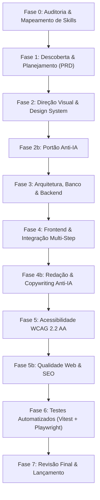
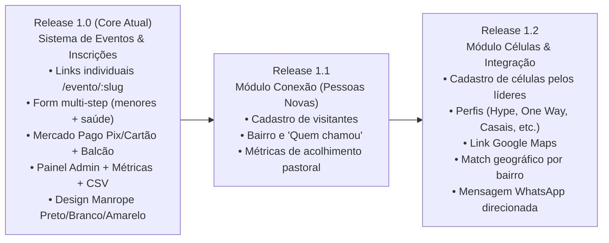

# ROADMAP.md — Cronograma de Execução e Dependências

## Sistema de Gestão de Eventos — Eira Church (White Label Edition)

---

## 1. Visão Geral das Fases do Projeto

---

## 2. Detalhamento de Tarefas por Fase

### Fase 0 — Preparação e Auditoria de Skills *(Concluída)*
- [x] **T0.1**: Auditoria dos diretórios `.agents/skills`, `~/.gemini/config/skills` e builtin.
- [x] **T0.2**: Geração do `SKILLS-MAP.md` com justificativa das substituições locais.
- [x] **T0.3**: Configuração de premissas iniciais em `ASSUMPTIONS.md`.
- **Dependência**: Nenhuma.
- **Estimativa**: 1h | Concluído.

---

### Fase 1 — Descoberta e Planejamento *(Fase Atual)*
- [x] **T1.1**: Levantamento de requisitos do negócio, definição de redes (Hype, One Way, Padrão) e modelo White Label.
- [x] **T1.2**: Elaboração do `PRD.md` com metas, personas, jornadas, MoSCoW e critérios BDD.
- [x] **T1.3**: Elaboração do `PRODUCT-CONTEXT.md` com proposta de valor e regras anti-slop.
- [x] **T1.4**: Elaboração do `ROADMAP.md` com matriz de dependências e estimativas.
- [x] **T1.5**: Integração da visão modular do ecossistema Eira Church (Eventos Core + Conexão + Células).
- **Dependência**: Fase 0 aprovada.
- **Estimativa**: 2.5h | Concluído.

---

### Fase 2 — Direção Visual e Design System
- [ ] **T2.1**: Elaboração de 2 direções visuais distintas (Direção A: *Minimalismo Arquitetônico Preto, Branco & Amarelo Industrial*; Direção B: *Editorial Monocromático com Alto Contraste Solar*).
- [ ] **T2.2**: Seleção da direção recomendada e submissão para aprovação.
- [ ] **T2.3**: Elaboração do `DESIGN.md` e `DESIGN-SYSTEM.md` com tokens de cores (contraste AA verificado), tipografia Manrope Display e Interface, escalas, sombras sutis de 1px e componentes com todos os estados (hover, active, focus-visible, disabled, loading, empty).
- **Dependência**: Fase 1 aprovada.
- **Estimativa**: 3h.

---

### Fase 2b — Portão Anti-IA
- [ ] **T2b.1**: Auditoria contra padrões clichês de IA (ausência de gradientes roxos/azuis, sem ícones genéricos em círculos coloridos, sem três cartões idênticos de preços, sem emojis como ícones funcionais).
- [ ] **T2b.2**: Entrega do `ANTI-IA-REPORT.md` com pontuação por critério e aprovação formal.
- **Dependência**: Fase 2 concluída.
- **Estimativa**: 1h.

---

### Fase 3 — Arquitetura, Banco de Dados e Backend
- [ ] **T3.1**: Modelagem relacional e DDL das tabelas `eventos`, `inscricoes`, `inscricao_tentativas` e view `eventos_com_contagem` (com suporte a roles `admin`, `pastor`, `lider` e campos para rastreamento de método de pagamento).
- [ ] **T3.2**: Configuração de políticas de Row Level Security (RLS) estritas e permissões de roles.
- [ ] **T3.3**: Função SQL e índices para rate limiting criptográfico (máx. 3 tentativas/hora/IP via hash SHA-256).
- [ ] **T3.4**: Desenvolvimento das Supabase Edge Functions (`criar-preferencia` e `webhook-mercadopago` com validação de assinatura HMAC-SHA256).
- [ ] **T3.5**: Elaboração do `ARQUITETURA.md` e checklist de segurança obrigatório.
- **Dependência**: Fase 2b aprovada.
- **Estimativa**: 4h.

---

### Fase 4 — Implementação do Frontend e Telas
- [ ] **T4.1**: Configuração dos tokens no Tailwind CSS e implementação dos componentes base (`Button`, `Input`, `Badge`, `Toast`, `Modal`, `ProgressBar`, `EventCardSkeleton`).
- [ ] **T4.2**: Implementação do formulário multi-step dinâmico com Zod e lógica condicional para menores de 18 anos e observações de saúde.
- [ ] **T4.3**: Construção da página inicial (`Home.tsx`) com grid de eventos, skeleton loaders e filtros por rede (Hype, One Way, Padrão).
- [ ] **T4.4**: Construção da página individual compartilhável (`EventoSlug.tsx`) com hero adaptativo e formulário autônomo.
- [ ] **T4.5**: Construção do painel administrativo (`Dashboard.tsx`, `Inscricoes.tsx`, `Eventos.tsx`, `EventoForm.tsx`) com KPIs, filtros debounce, alteração de status (com registro de método: Pix, Cartão, Dinheiro/Secretaria) e exportação CSV com BOM UTF-8.
- **Dependência**: Fase 3 aprovada.
- **Estimativa**: 6h.

---

### Fase 4b — Redação e Copywriting Anti-IA
- [ ] **T4.1**: Redação de todos os textos, títulos de eventos, CTAs e microcopy com base no `PRODUCT-CONTEXT.md`.
- [ ] **T4.2**: Auditoria de copy com eliminação de jargões e clichês de IA.
- [ ] **T4.3**: Entrega do `COPY.md` e aplicação direta no código-fonte.
- **Dependência**: Fase 4 concluída.
- **Estimativa**: 1.5h.

---

### Fase 5 — Acessibilidade e Inclusão (WCAG 2.2 AA)
- [ ] **T5.1**: Auditoria de navegação por teclado, focus trap em modais e restauração de foco ao fechar.
- [ ] **T5.2**: Validação de leitores de tela (`aria-live`, `aria-describedby`, `aria-current="step"`, tabelas com `<th scope="col">` e botões de ação com nomes acessíveis completos).
- [ ] **T5.3**: Verificação de contraste de cores (mínimo 4.5:1 para texto normal e 3:1 para display) e alvos de toque ≥ 44x44px.
- [ ] **T5.4**: Entrega do `A11Y-REPORT.md`.
- **Dependência**: Fase 4b aprovada.
- **Estimativa**: 2h.

---

### Fase 5b — Qualidade Web, Performance e SEO
- [ ] **T5b.1**: Otimização de performance (LCP ≤ 2.0s, CLS ≤ 0.05, code splitting no admin via `React.lazy`).
- [ ] **T5b.2**: Implementação de metadados Open Graph dinâmicos e schema.org tipo `Event` para compartilhamento rico no WhatsApp e Instagram.
- [ ] **T5b.3**: Auditoria de botões e links contra dead-clicks via `ui-route-button-interaction-audit`.
- [ ] **T5b.4**: Entrega do `QUALITY-REPORT.md`.
- **Dependência**: Fase 5 concluída.
- **Estimativa**: 1.5h.

---

### Fase 6 — Testes Automatizados
- [ ] **T6.1**: Testes unitários com Vitest (funções puras: `slugify`, `formatters`, `exportCsv`).
- [ ] **T6.2**: Testes de integração com MSW e Testing Library (fluxo de formulário multi-step, bloqueios por campo obrigatório, salto de pagamento em evento gratuito).
- [ ] **T6.3**: Testes E2E com Playwright (inscrição pública pela home, link direto `/evento/:slug`, login admin e confirmação de pagamento).
- [ ] **T6.4**: Entrega do `TEST-REPORT.md` com cobertura ≥ 70%.
- **Dependência**: Fase 5b aprovada.
- **Estimativa**: 3h.

---

### Fase 7 — Revisão Final e Lançamento
- [ ] **T7.1**: Limpeza de código, remoção de logs de depuração e verificação final de segredos.
- [ ] **T7.2**: Execução final do portão anti-IA.
- [ ] **T7.3**: Elaboração do `LAUNCH-CHECKLIST.md` e documentação de execução no `README.md`.
- **Dependência**: Fase 6 aprovada.
- **Estimativa**: 1h.

---

## 3. Releases do Ecossistema Eira Church

